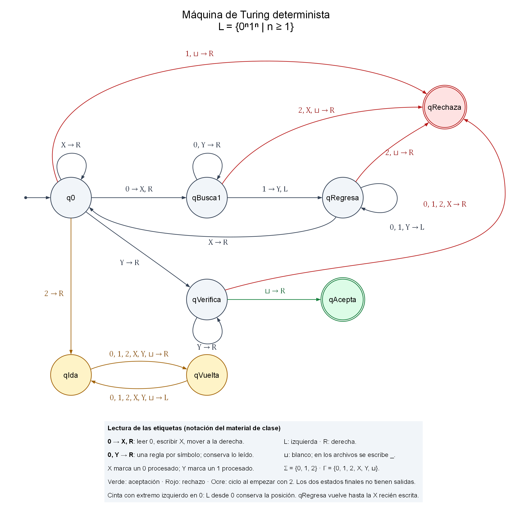

# Simulador de máquina de Turing determinista

Programa en Python que carga una máquina de Turing y una cadena desde texto,
valida sus componentes y escribe las configuraciones en otro archivo.
El modelo tiene **una cinta con extremo izquierdo en la posición 0** y crece
hacia la derecha. Una transición L desde 0 escribe y cambia de estado, pero
mantiene el cabezal en 0, según la página 1 del material de clase `Turing.pdf`.

## Ejecutar

Se necesita Python 3.10 o posterior. El simulador y las pruebas usan únicamente
la biblioteca estándar; no hay paquetes que instalar.

```powershell
python simulador.py ejemplos/aceptacion.txt -o salidas/aceptacion.txt
python simulador.py ejemplos/rechazo.txt -o salidas/rechazo.txt
python simulador.py ejemplos/ciclo.txt -o salidas/ciclo.txt --max-pasos 12
python simulador.py --help
python -m unittest discover -s tests -v
```

Si Windows no reconoce `python`, prueba `py`. La carpeta de salida debe existir.
`-o` sobrescribe la salida indicada; el programa impide usar la propia entrada.

| Archivo de entrada | Cadena | Resultado | Transiciones |
|---|---|---|---|
| ejemplos/aceptacion.txt | 0011 | ACEPTADA | 13 |
| ejemplos/rechazo.txt | 001 | RECHAZADA | 8 |
| ejemplos/ciclo.txt | 2 | LIMITE_ALCANZADO | 12, por el límite elegido |

Los tres archivos describen la misma máquina; solo cambia `entrada:`. Las salidas
incluyen la configuración inicial: 14, 9 y 13 configuraciones, respectivamente.

## Máquina diseñada

Reconoce **L = {0ⁿ1ⁿ | n ≥ 1}**. Marca cada 0 con X y busca un 1 para marcarlo
con Y. `qRegresa` retrocede sobre 0, 1 e Y hasta la **X del cero recién emparejado**.
Al leer esa X, conserva el símbolo, mueve R y vuelve a q0. Así continúa con el
siguiente cero pendiente sin buscar un blanco fuera del extremo izquierdo.

Cuando q0 encuentra Y, pasa a qVerifica, que acepta solamente si quedan Y hasta
el blanco. La cadena vacía, 001, 011 y 0101 se rechazan. Las entradas que empiezan
con 2 activan una oscilación entre qIda y qVuelta. Un 2 en otra posición provoca
rechazo. La máquina reconoce L, pero no es un decisor sobre Σ*.

Formalmente **M = (Q, Σ, Γ, δ, q0, qAcepta, qRechaza)**:

- Q = {q0, qBusca1, qRegresa, qVerifica, qIda, qVuelta, qAcepta, qRechaza}.
- Σ = {0, 1, 2}.
- Γ = {0, 1, 2, X, Y, _}; el blanco pertenece a Γ y no a Σ.
- δ contiene 36 reglas: seis estados no finales por seis símbolos.
- qAcepta y qRechaza son distintos, finales y no tienen salidas.

Las dos reglas que adaptan el regreso son:

```text
qRegresa X -> q0 X R
qRegresa _ -> qRechaza _ R
```

La segunda completa la función para un caso que no se alcanza durante un
emparejamiento válido. El simulador limita el movimiento L por su modelo general;
la máquina de ejemplo reconoce su punto de regreso mediante X en la propia cinta.

## Diagrama y configuraciones



`diagrama.svg` permite ampliar. `diagrama.dot` conserva posiciones fijas para
regenerarlo con Graphviz:

```powershell
neato -n2 -Tsvg diagrama.dot -o diagrama.svg
neato -n2 -Tpng -Gdpi=120 diagrama.dot -o diagrama.png
```

Las etiquetas siguen el material de clase: `0 → X, R` significa leer 0, escribir
X y mover a la derecha. `X → R` conserva X. `0, Y → R` representa una regla por
símbolo. L significa izquierda y R, derecha. El blanco se dibuja ⊔ y en los
archivos se escribe `_`.

Se escribe **α q β**; el cabezal lee el primer símbolo de β. Cada configuración
empieza en la celda 0, conservando blancos iniciales si se borran símbolos.
Solo se omiten blancos finales innecesarios. C0 es inicial y ⊢ indica un paso.

Ejemplo completo para 01:

```text
C0: q0 01
⊢ C1: X qBusca1 1
⊢ C2: qRegresa XY
⊢ C3: X q0 Y
⊢ C4: XY qVerifica _
⊢ C5: XY_ qAcepta _
```

## Formato y validación

Los campos deben aparecer antes de `transiciones:`. Se permiten comentarios
iniciados por #, líneas vacías y archivos UTF-8 con o sin BOM.

```text
estados: q0 qBusca1 qRegresa qVerifica qIda qVuelta qAcepta qRechaza
alfabeto_entrada: 0 1 2
alfabeto_cinta: 0 1 2 X Y _
blanco: _
inicial: q0
aceptacion: qAcepta
rechazo: qRechaza
entrada: 0011
transiciones:
# Fragmento: agregar las 36 reglas, como en ejemplos/aceptacion.txt.
q0 0 -> qBusca1 X R
```

Cada regla tiene seis tokens: origen, leído, ->, destino, escrito y L/R. Cada
símbolo ocupa un carácter. Los símbolos #, : y los espacios están reservados
para el formato. Para la cadena vacía se deja `entrada:` sin valor.

Se validan los campos, los conjuntos sin repetidos, los nombres de estado,
Σ ⊆ Γ, el blanco, la entrada, los estados distinguidos, los símbolos y estados
de cada regla, los movimientos, la ausencia de salidas desde finales y la función
δ total y determinista. Un error de especificación impide ejecutar; no equivale
a una cadena rechazada por la máquina.

## Cinta, límite y pruebas

El diccionario de celdas representa la única cinta. Sus posiciones son enteros
no negativos; una posición ausente contiene blanco. Leer o escribir una posición
negativa mediante la clase Cinta produce un error. La tabla δ es la descripción
fija de la máquina. No se emplean contadores de ceros y unos ni una segunda cinta.
La salida se escribe progresivamente y no se consulta para decidir transiciones.

El límite predeterminado es 1000. `--max-pasos 0` muestra solo C0. Alcanzar el
límite no prueba un ciclo ni es rechazo. Para 2, C1 y C3 tienen el mismo estado,
cinta y cabezal: esa repetición completa y el determinismo justifican el ciclo.

Las **10 pruebas** ejecutan `simulador.py` mediante procesos separados. Funcionan
con la llamada directa a main y no importan el programa. Comprueban las 511
cadenas binarias de longitud 0 a 8, una traza exacta, el extremo izquierdo, la
escritura y cambio de estado al aplicar L desde 0, el borrado y los blancos
iniciales, los límites, los errores y las tres salidas. Solo las pruebas pueden
usar varios procesos para reducir el tiempo de verificación; la MT sigue siendo
una máquina determinista de una sola cinta.

## Material de entrega y estudio

| Inciso | Archivos |
|---|---|
| a: programa | simulador.py |
| b: diseño | diagrama.png, diagrama.svg, diagrama.dot |
| c-d: aceptación | ejemplos/aceptacion.txt, salidas/aceptacion.txt |
| e-f: rechazo | ejemplos/rechazo.txt, salidas/rechazo.txt |
| g-h: ciclo | ejemplos/ciclo.txt, salidas/ciclo.txt |
| Informe | Parcial_4_Maquina_de_Turing.pdf |
| Estudio | Guion.md y Resumen_codigo.md |

La carga a Canvas y la exposición corresponden al estudiante. Se entregan los
archivos, no enlaces a un repositorio. `respaldo/antes_extremo_izquierdo.zip`
conserva la versión anterior solo para recuperación; no forma parte de la entrega.

Para regenerar el informe se incluye `herramientas/generar_informe.py`. Esa
herramienta de documentación requiere `reportlab`, `pypdf` y las fuentes de
Windows, además del respaldo para recuperar la portada y las reflexiones.
Estas dependencias no son necesarias para ejecutar el simulador ni sus pruebas.
